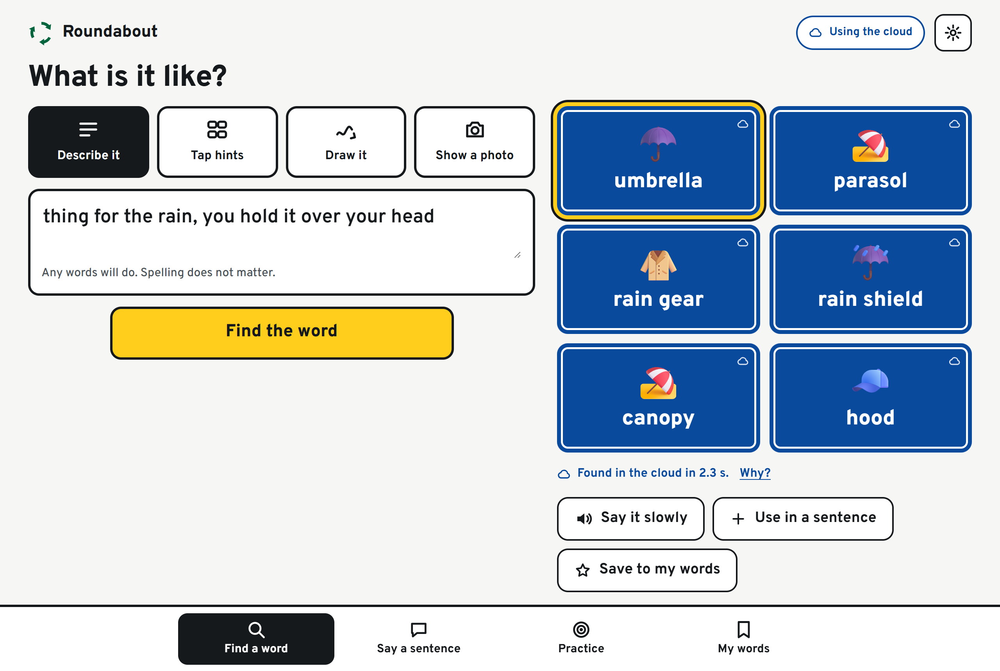
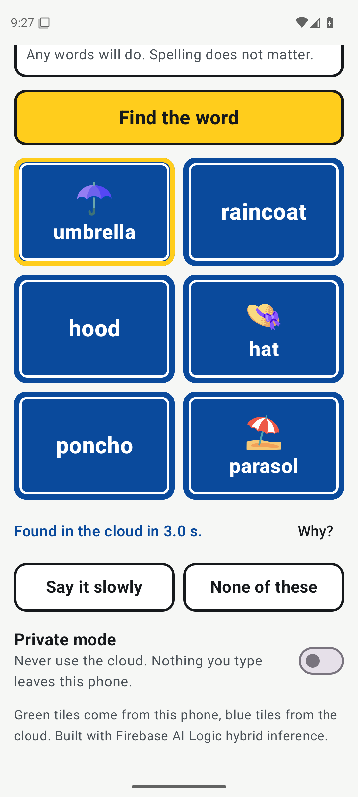
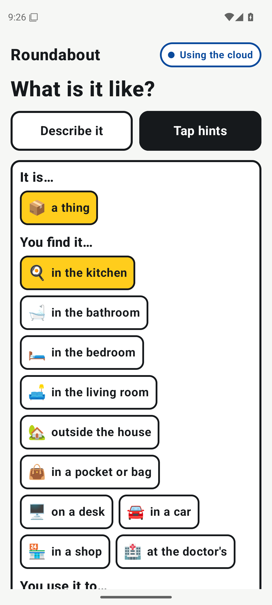

# Roundabout

**A word-finding aid for people with aphasia.** When a word will not come, describe it, tap a few hints, draw it or show a photo. Roundabout offers the word and says it aloud. It answers on the device when it can, and uses the cloud when the device cannot.

Live: https://roundabout-words.web.app
<!-- VIDEO -->

Built for #BuildHybridAI 2026 with **Firebase AI Logic hybrid inference** (Gemini Nano on the device, Gemini in the cloud).



## The problem

Aphasia is a language disorder, most often caused by a stroke. Studies put it at 18–38% of stroke survivors, and estimates for the United States run from one to two and a half million people. Intelligence is intact. The most common symptom is *anomia*: the person knows exactly what they mean, and the word will not come.

Speech therapists teach a way round: **talk around the word** (describe it, say what it is for, where it lives), or draw it. That works when the listener is patient and good at guessing. Roundabout is that listener, in a pocket.

> When the direct road to a word is closed, take the roundabout.

## Why this needs both an on-device model and the cloud

A voice that needs Wi-Fi is not a voice.

| | On the device (Gemini Nano) | In the cloud (Gemini) |
|---|---|---|
| Speed | Answers at the pace of a conversation | A network round trip |
| Offline | Works on a hospital ward, in a car park, outdoors | Needs a connection |
| Privacy | What a person is trying to say never leaves the device | Sent to Google's servers |
| Cost | Free, however many times a day it is used | Free tier, with limits |
| Reach | Only recent, capable devices | Every device with a browser |
| Knowledge | Everyday words | Names, rare words, harder pictures |

So neither side is enough alone. Roundabout uses each for what it is good at, and says which one answered.

## How a request is routed

One function, [`web/src/core/route.ts`](web/src/core/route.ts), picks a Firebase AI Logic inference mode for each job. The SDK then does the switching and reports the side that answered (`inferenceSource`).

| Job | Mode | Why |
|---|---|---|
| Find a word, name a drawing or photo, build a sentence, practice hints | `PREFER_ON_DEVICE` | Short jobs. The device answers; the cloud covers devices with no on-device model. |
| Guesses while typing, tapping hints or drawing | `ONLY_ON_DEVICE` | Many small requests. They cost nothing and stay private, so they never go to the cloud. |
| Same jobs while the on-device model is still loading | `PREFER_IN_CLOUD` | Do not make the person wait for a model to load. The SDK falls back to the device if the cloud fails or its quota runs out. |
| The person tapped "something you do" or "a feeling" | `PREFER_IN_CLOUD` | Measured: the small model finds objects and places well, actions and feelings poorly (numbers below). So these two go to the cloud first, and to the device when the cloud cannot be reached. |
| A clue of three words or fewer, answered on the device | then `ONLY_IN_CLOUD` | Very short clues are also hard for a small model, so the cloud adds its ideas as blue tiles beside the green ones. |
| "None of these": a second opinion | `ONLY_IN_CLOUD` | The bigger model looks again, told what was already offered. |
| Private mode (a setting) | `ONLY_ON_DEVICE` | Nothing leaves the device, ever. |

On top of the SDK's own fallback, [`web/src/core/find.ts`](web/src/core/find.ts) adds four things the SDK does not do:

- **A slow device is covered by the cloud.** If an on-device call fails or does not start answering in time, the same request is sent to the cloud.
- **A slow cloud is covered by the device.** When the cloud is asked first and has not started answering after 1.5 seconds, the on-device model answers meanwhile (green tiles), and the cloud's words are added in blue when they arrive.
- **A slow cloud model is covered by another cloud model.** A device with no on-device model has only the cloud, and a free cloud model is not always quick. In the accuracy run 41 of 255 cloud requests took more than 3 seconds to start answering. On the evening of the same day the model reported "high demand" and held most requests for 8 seconds or more (the longest for 43 seconds), while a second cloud model was answering the same request in under a second. So a cloud request that has not started answering after 1.5 seconds is also sent to the next cloud model on a short list, then the next, up to four requests. The first to start answering is used and the others are dropped. The model that answered is asked first for the next few minutes. The list and the delay are Remote Config values; the logic is in [`web/src/core/hedge.ts`](web/src/core/hedge.ts).
- **A used-up quota does not stop the app.** A cloud model that says its quota is used up is rested for as long as its reply asks (half an hour at most) while the other cloud models and the device carry on. Only when every cloud model is resting does the app say that the cloud is resting. This happened for real on the test day: the main cloud model reached its free limit of 500 requests a day, and the live site carried on with the backup model. The small request for missing tile pictures asks a backup model first, to keep the main model's daily quota for finding words.

The line under the tiles always says what happened, including when the cloud was asked as well. "Nothing was sent" is shown only when that is true.

Before any model runs, saved words are matched against the clues in plain code, so "my granddaughter" finds *Layla* instantly, offline, on any device.

Tiles are coloured like road signs: **green** found on this device, **blue** from the cloud, **brown** one of your saved words.

## How often it finds the word

Measured on two test sets whose clues were written by someone who had not seen the prompts: the 175 nouns of the Philadelphia Naming Test (a standard naming test in aphasia research) and 80 everyday words that are not simple objects. Each word has a clear clue, a broken and halting one, and one of two to four key words. The test runs the app's own code. Full tables, every miss and the scoring rule are in [`docs/ACCURACY.md`](docs/ACCURACY.md), which is generated from the raw results in [`eval/`](eval).

| Test set | Side | Tries | Right word first | In the first three | Among the six tiles | First tile after |
|---|---|---|---|---|---|---|
| 175 naming-test nouns | Device (Gemini Nano) | 525 | 89.5% | 95.6% | 96.0% | 0.9 s |
| 175 naming-test nouns | Cloud | 175 | 99.4% | 100% | 100% | 1.1 s |
| 80 everyday words | Device (Gemini Nano) | 240 | 57.9% | 69.6% | 74.6% | 0.9 s |
| 80 everyday words | Cloud | 80 | 82.5% | 92.5% | 95.0% | 1.8 s |

The second set shows where the small model stops. Among the six tiles, on the device and in the cloud:

| Kind of word | Device | Cloud |
|---|---|---|
| Places | 100% | 100% |
| People (dentist, nephew, landlord) | 90% | 100% |
| Actions (borrow, apologise, yawn) | 57% | 90% |
| Feelings and times (worried, relieved, tomorrow) | 52% | 90% |

So the device is the right first answer for things and places: nearly as accurate as the cloud, a little faster to the first tile, free, private and offline. For actions and feelings the cloud is clearly better, and the routing rule above sends those there first. That rule came from this measurement, not the other way round.

The cloud rows above are the main cloud model. The backup cloud model, which answers when the main one is slow or out of quota, was measured on the same words: on the nouns the right word came first in 98.9% of 175 tries and was among the first three every time; on the everyday words it came first in 78.8% of 80 tries and was among the six tiles in 91.3%.

These numbers say how often a model finds a word from a written clue. They do not say whether Roundabout helps a person with aphasia in a real conversation; that needs testing with people who have aphasia, which has not been done.

## Fast enough for a conversation

The first version asked the model for six words, each with a picture, as JSON objects. On the device that took about four seconds, slower than the cloud. Three changes brought the first word to under a second:

- **Ask for less.** The model returns only `{"words": [...]}`. Fewer tokens out is the one thing that makes a small on-device model faster.
- **Look pictures up, do not generate them.** [`shared/emoji.json`](shared/emoji.json) maps about 2,500 everyday words to a picture ([`web/src/core/pictures.ts`](web/src/core/pictures.ts)). Only a word the table does not know costs one more small request.
- **Stream.** Tiles appear as each word arrives (`generateContentStream`, read while still incomplete in [`web/src/core/guess.ts`](web/src/core/guess.ts)), so the likeliest word is on screen first.

## Offline

A small service worker ([`web/public/sw.js`](web/public/sw.js)) keeps a copy of the app itself after the first visit. With an on-device model, Roundabout then opens and finds words with no connection at all. Saved words, practice and the device's own voice work offline on every device.

## What it does

- **Find a word**, four ways:
  - *Describe it*: any words, in any order, misspelled is fine.
  - *Tap hints*: one question at a time (what kind of thing, where, what for, what it is like). This follows Semantic Feature Analysis, a standard therapy technique for anomia.
  - *Draw it*: drawing is a recognised strategy when words fail.
  - *Show a photo*.
- **Say a sentence**: a few key words become three full sentences to choose from, plain, polite or firm. Sentences are spoken with a natural Gemini voice when the cloud is reachable, and with the device's own voice otherwise.
- **Practice**: naming practice with a cueing hierarchy, the order a therapist gives hints in: what it means, a sentence to finish, the first letter, and only then the word.
- **My words**: names and words that matter (family, places). They are offered first when a clue matches.
- **A helper can add words from their own device**: the person shows an 8-character code that works for 15 minutes; a family member types it in and can then add names to the list, which appear on the person's device at once. Sharing is off until the person turns it on.
- **Private mode**: one switch, and nothing is ever sent to the cloud.

## Android

The Android app is in [`android/`](android/): Kotlin and Jetpack Compose, with the same word-finding flow as the web app.

- **Hybrid inference.** [`ai/Hybrid.kt`](android/app/src/main/java/app/roundabout/words/ai/Hybrid.kt) builds Firebase AI Logic models with `OnDeviceConfig(mode = ...)` in all four inference modes. On a phone with Gemini Nano (through the Prompt API from ML Kit) the answer comes from the phone; on any other phone the SDK falls back to the cloud model. `inferenceSource` decides the colour of the tiles.
- **One answer shape for both sides.** The answer is a `@Generable` data class ([`ai/Schemas.kt`](android/app/src/main/java/app/roundabout/words/ai/Schemas.kt)). The SDK turns it into an output constraint for the on-device model and a JSON schema for the cloud model.
- **The same rules and the same words as the web app.** The routing rule, the covers for a slow side and the asking-again logic are plain Kotlin in [`core/`](android/app/src/main/java/app/roundabout/words/core/), written to match `web/src/core`. The app reads the files in [`shared/`](shared/) as its assets, so both platforms send the same prompts and show the same hint chips and pictures.
- **App Check.** Debug builds use the debug provider: the token is made on the phone, shown on screen when a request is refused, and registered in the console. Release builds use Play Integrity.
- **Built and tested in GitHub Actions** ([`.github/workflows/android.yml`](.github/workflows/android.yml)), with no Firebase settings in the repository. 34 unit tests cover routing, the covers and word cleaning with a stand-in model. The app is then installed on an emulator, where [`scripts/android-shots.py`](scripts/android-shots.py) taps through it, asks for a real word and takes screenshots. The App Check debug token for that run is a repository secret that is handed to the app at run time; it is not in the app file.

 

*The Android app on the emulator in GitHub Actions. An emulator has no on-device model, so the cloud answered and the tiles are blue.*

Status on 13 November: the app builds and its 34 unit tests pass. On the emulator it finds a word through the cloud, with App Check enforced (11 of 11 checks: it opens, the hints work, a typed clue returns word tiles with *umbrella* among them, and the line under the tiles says which side answered). Answers from Gemini Nano on Android have not been verified yet: that needs a phone that has the on-device model, which an emulator does not. Describing and tapping hints are in the Android app; drawing, photos, sentences, practice and saved words are in the web app only.

To build it yourself: put `FB_API_KEY`, `FB_APP_ID`, `FB_PROJECT_ID` and `FB_SENDER_ID` in `android/.env` (`node scripts/fetch-android-config.mjs` writes that file for your own Firebase project), then run `./gradlew :app:assembleDebug` in `android/`.

## One prompt pack for every platform

[`shared/prompts.json`](shared/prompts.json) holds every system prompt and JSON schema, and [`shared/hints.json`](shared/hints.json) the hint chips. On the web the same schema is passed to Gemini Nano as `responseConstraint` and to the cloud model as `responseSchema`, so both sides return the same shape and can be compared like for like. The Android app reads the same files.

## Firebase

- **Firebase AI Logic**: every model call ([`web/src/core/ai.ts`](web/src/core/ai.ts)): hybrid inference in all four modes, structured output, image input, and text-to-speech for the natural voice ([`web/src/core/speech.ts`](web/src/core/speech.ts)).
- **App Check** with reCAPTCHA Enterprise, enforced for AI Logic and for Firestore. A request without a token is refused (`node scripts/check-appcheck.mjs` shows the 401).
- **Remote Config** ([`web/src/core/remote.ts`](web/src/core/remote.ts), [`remoteconfig.template.json`](remoteconfig.template.json)): the cloud model names (the main one and the backups), the number of guesses, the time limits for a slow device and a slow cloud, the voice switch and even prompt text can be changed without a release. Values are checked before use, so a typo in the console cannot break the app.
- **Authentication** (anonymous sign-in, no email or password) and **Cloud Firestore** for sharing saved words with a helper ([`web/src/core/sync.ts`](web/src/core/sync.ts)). The words stay readable offline. This code is only downloaded when sharing is turned on.
- **Security rules** ([`firestore.rules`](firestore.rules)): only the person and the helpers they admitted can read or change their words; every write is checked for shape and size.
- **Hosting** for the web app.
- Project set-up is scripted in [`scripts/`](scripts): `fetch-web-config.mjs`, `provision-ailogic.cjs`, `setup-appcheck.cjs`.

The project is on the free Spark plan with no billing account, so the cloud side cannot cost money.

One measured trade-off: one-time-use App Check tokens (replay protection) add about half a second to every cloud request. In a conversation that is a lot, so they are off by default and can be switched on from Remote Config.

## Run it

```bash
cd web
npm install
cp .env.example .env.local     # then fill it in, or run the two set-up scripts from the repo root
npm run dev                    # http://localhost:5196
npm test                       # unit tests
```

On-device answers need Chrome on a desktop computer that can run Gemini Nano. Everywhere else Roundabout works through the cloud.

## Tests

- `npm test` (in `web/`): unit tests for the routing rule, asking again when an answer is slow to start, cleaning model output into tiles, saved-word matching, the hint chips and the remote settings checks.
- `node scripts/e2e-device.mjs`: drives the live site in real Chrome with Gemini Nano, 18 checks: the cloud answering while the on-device model loads, answers on the device with no model request leaving the machine, guesses while typing, the cloud adding ideas for a short clue, private mode, hints, an action going to the cloud first with the device covering for a late cloud reply, drawing, sentences, and finding a word after a reload with the network off.
- `node scripts/e2e-cloud.mjs`: drives the live site in a browser with no on-device model: describe, hints, drawing, photo, sentences, the natural voice, saved words, a saved word still found when every model request fails, a slow cloud, a slow cloud model covered by a second request, private mode, offline, Remote Config, and a check that every model request goes to Firebase AI Logic.
- `node scripts/rules-test.mjs`: three real anonymous users (owner, helper, stranger) try 45 operations against the deployed security rules.
- `node scripts/e2e-share.mjs`: two browsers on the live site, one person and one helper: invite code, a name added by the helper appears on the other device, removal cuts access.
- `./gradlew :app:testDebugUnitTest` (in `android/`): 34 unit tests of the Android app's routing, covers, asking again and word cleaning. GitHub Actions runs them on every change, then runs the app on an emulator.
- `node scripts/eval.mjs cloud|device eval/pnt.json`: accuracy on an independent test set (see [`docs/ACCURACY.md`](docs/ACCURACY.md)).

## Limits, stated plainly

- Roundabout has not yet been tested with people who have aphasia. It is built from published therapy techniques and aphasia-friendly design guidance, not from clinical trials.
- It is a communication aid, not a medical device, and it does not replace speech and language therapy.
- The cloud side runs on the free tier, which has limits per project. On 12 November the service stated them in its replies: 500 requests a day for the main cloud model, and 15 requests a minute for the first backup model. When one model's quota is used up the app moves to the next, and a device with an on-device model keeps working with no cloud at all. A public launch would need a paid plan.
- Similar tools exist (naming-therapy apps, and at least one app that suggests words from sketches). Roundabout's contribution is finding a word from a loose description or tapped hints, working offline on the device, and falling back to the cloud on devices that cannot.

## Licence

Apache-2.0. All names and examples in this repository are fictional.
